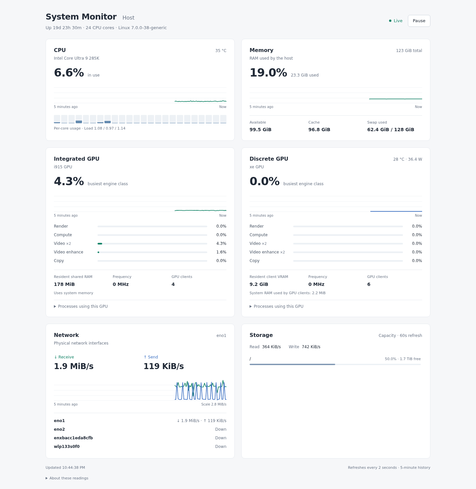

# System Monitor

A system monitor web app showing CPU, RAM, GPU, network and storage usage.



Requires Linux 5.12+ and rootful Docker Compose. Example `compose.yaml`:

```yaml
services:
  collector:
    build: .
    user: "0:0"
    command: ["python", "collector.py"]
    restart: unless-stopped
    network_mode: none
    read_only: true
    cap_drop: [ALL]
    cap_add: [SYS_PTRACE, DAC_READ_SEARCH]
    security_opt: ["no-new-privileges:true", "apparmor=unconfined"]
    volumes:
      - /proc:/host/proc:ro
      - /sys:/host/sys:ro
      - /:/host/root:ro
      - metrics:/data
    configs:
      - source: collector
        target: /config/config.json
  web:
    build: .
    restart: unless-stopped
    read_only: true
    cap_drop: [ALL]
    security_opt: ["no-new-privileges:true"]
    ports: ["127.0.0.1:${PORT:-8080}:8080"]
    volumes: ["metrics:/data:ro"]
configs:
  collector:
    file: ./config.example.json
volumes:
  metrics:
```

```sh
docker compose up -d --build
```

Open <http://localhost:8080>. Set `PORT` to change the port.
Edit [config.example.json](config.example.json) for host labels and filesystem paths.
No login; use a trusted network if changing the loopback bind.
